# VELOOP Rewards — Level-Up Dashboard

> Task 16 · Complete Level-Up Dashboard Redesign — a premium, fintech-inspired **Level-Up + Rewards + Games + Earning hub** for VELOOP Rewards.

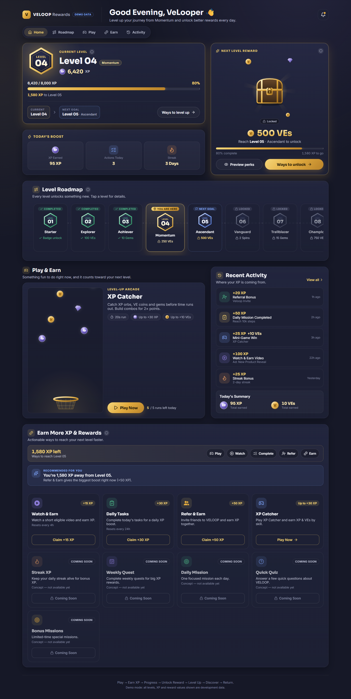

| | |
|---|---|
| **Live demo** | `https://<your-project>.vercel.app/Lvl-Dashboard` ← _add after deploying_ |
| **Repository** | `https://github.com/<your-username>/<repo>` ← _add after pushing_ |
| **Route** | `/Lvl-Dashboard` (plus `/Lvl-Dashboard/activity`) |

---

## 1. Project Overview

The old Level Dashboard showed a number. This one answers six questions at a glance and gives the user a reason to come back:

| Question | Where it is answered |
|---|---|
| Where am I now? | **Level Hero**: hex badge, level number, level name |
| How far have I come? | **Current XP** with an animated count-up |
| What do I need next? | **"1,580 XP to Level 05"**, always spelled out, never calculated by the user |
| What will I unlock? | **Next Level Reward**: locked chest card with a perks preview |
| What can I do right now? | **Play & Earn** (XP Catcher mini-game) and **Earn More XP & Rewards** |
| Why return? | Level roadmap, daily game attempts, cooldown-based earning, streaks |

Engagement loop: **Play → Earn XP → Progress → Unlock Reward → Level Up → Discover → Return**.

It's a completely new UI, layout and interaction model. Only the **data and functionality** of the existing page are kept: the same API, the same `/Lvl-Dashboard` and `/Lvl-Dashboard/activity` routes, claimable earning features with cooldowns, the game session with daily attempts, and the level-up celebration.

## 2. Level System

- Levels come from `GET /api/levels`: `Starter → Explorer → Achiever → Momentum → Ascendant → Vanguard → Trailblazer → Champion → Legend → Mythic`, each with a reward (VEs, Gems or Spins).
- Four visual states. Every state has an icon and a text label, so meaning never depends on colour alone:

| State | Label | Treatment |
|---|---|---|
| Completed | ✓ Completed | green hex, reward ticked |
| Current | 📍 You are here | gold hex, highlighted card |
| Next | 🚩 Next goal | blue dashed card, reward in gold |
| Locked | 🔒 Locked | muted hex, reward shown locked |

- Clicking any level opens a **Level Detail** dialog with its reward, XP threshold (when known) and perks.
- At max level the hero reads "Max level reached" and the reward card shows an open chest. Nothing divides by zero.

## 3. XP System

- `GET /api/profile` provides `currentLevel`, `currentLevelName`, `currentXP`, `nextLevel`, `requiredXP`, `xpToNext`, `progressPct`, `nextLevelReward`.
- The XP bar is a real `role="progressbar"` with `aria-valuetext` ("6,420 of 8,000 XP, 1,580 XP to Level 05"). It fills with an ease-out animation on load, and a subtle shine runs across it.
- **Today's Boost** (XP earned today, actions today, streak days) is derived from the activity feed in `src/utils/activityStats.js`.
- **Recent Activity** lists the latest XP events with their source (tasks, referrals, games, streaks, watch & earn) and a Today's Summary. The full history with filters is at `/Lvl-Dashboard/activity`.

## 4. Next-Level Rewards

- A dedicated gold **Next Level Reward** card: a locked chest with floating VE coins and gems, slow light rays, the reward amount, "Reach Level 05 · Ascendant to unlock", and a progress bar.
- Hovering lifts the chest. **Preview perks** reveals what the next level unlocks.
- An [i] tooltip explains in plain words that the reward comes from the current reward configuration.
- **Level-up celebration:** a restrained modal with a badge reveal, the level number moving from 04 to 05, coins drifting, subtle particles (no confetti storm), reward tiles, a perks list and **Claim Rewards**. It fires when a game or claim response reports `levelUp`. Preview it with `?demo=levelup`.

## 5. Game Concept — XP Catcher

A skill-based, 20-second catching game in the **Level-Up Arcade** (Play & Earn section). You move a gold basket to catch falling XP orbs, VE coins and gems while avoiding dud blocks. It plays in a modal, full screen on phones, and follows the approved mockup.

States: **Start (rules) → 3-2-1 countdown → Gameplay → Submitting → Result → Replay**, plus out-of-attempts and error states.

Architecture keeps **prototype logic separate from reward logic**:

- `src/game/engine.js`: a pure engine (spawn, move, collide, combo, speed-up). No React and no rewards.
- `src/game/rewardRules.js`: **demo** reward tiers only.
- `src/api/services.js → submitGameSession(score)`: in live mode the server (`POST /api/game/session`) decides the reward. In mock mode the demo tiers are used.

## 6. Game Rules

Everything below is shown to the player on the start screen. There are no hidden mechanics.

| Rule | Value |
|---|---|
| Objective | Catch falling items in the gold basket |
| Controls | Drag or pointer / touch; keyboard ← → or A D |
| Time limit | 20 seconds per run |
| Scoring | XP orb **+5**, VE coin **+3**, Gem **+10**, Dud **−5** (score never drops below 0) |
| Combo | 5 catches in a row → **2× points** until you miss a good item or catch a dud |
| Difficulty | Fall speed ×1.2 every 5 seconds |
| Rewards (**demo values**) | Score 0–39 → +10 XP · 40–79 → +20 XP · 80+ → +30 XP +10 VEs |
| Attempts | **5 runs per day**, reset at local midnight; "Next attempt in HH:MM:SS" |
| Eligibility | Skill-based only, with no chance, betting or jackpots. Final rewards are confirmed by VELOOP |

## 7. Earning Features

**Earn More XP & Rewards** turns the page into an action hub:

- **"1,580 XP left: ways to reach Level 05"** quick actions (Play, Watch, Complete, Refer, Earn) jump to the relevant card.
- **Recommended for you** suggests the best available action based on your progress, e.g. "Just one more activity could level you up".
- Interactive cards with a hover lift and gold CTA emphasis:

| Feature | Source | Behaviour |
|---|---|---|
| Watch & Earn | API | Claim +15 XP, 4 h cooldown countdown |
| Daily Tasks | API | Claim +30 XP, 24 h cooldown |
| Refer & Earn | API + UI | Opens **Invite Friends**: personal referral code and link (demo code), copy link, share to WhatsApp / Telegram / X / Email / native share. Sharing unlocks the real **+50 XP** claim. Milestones (1/3/5 friends) are *Coming Soon* until a referral API exists |
| XP Catcher | UI | Opens the mini-game |
| Streak XP, Weekly Quest | API `coming_soon` | **Coming Soon**, disabled |
| Daily Mission, Quick Quiz | Concepts | **Coming Soon**: "Concept, not available yet" |

Claims call `POST /api/earning-features/:key/claim`, then refresh the profile, levels, activity and features.

## 8. Technology Stack

React 18 · Vite 5 · React Router 6 · TanStack Query 5 · Bootstrap 5 (grid + utilities only) · CSS Modules (`*.module.css`) · React Hooks · lucide-react · react-icons · Vitest + Testing Library.

## 9. Installation

```bash
git clone https://github.com/<your-username>/<repo>.git
cd <repo>
npm install
cp .env.example .env        # optional
```

| Variable | Default | Meaning |
|---|---|---|
| `VITE_USE_MOCK` | `false` | `true` = run fully on local demo data (`src/data/mockData.js`) |
| `VITE_API_BASE_URL` | _(empty)_ | Empty = same-origin `/api` proxy (recommended) |

> **Why a proxy?** The VELOOP API only allows CORS requests from its own client, so `/api/*` is proxied same-origin: by Vite in development and by `vercel.json` rewrites in production.

## 10. Development Commands

```bash
npm run dev          # http://localhost:5173/Lvl-Dashboard (live API via proxy)
VITE_USE_MOCK=true npm run dev   # demo data, no network needed
npm test             # unit + component tests (Vitest)
npm run build        # production build → dist/
npm run preview      # serve the production build (with /api proxy)
```

On Windows PowerShell, use `$env:VITE_USE_MOCK="true"; npm run dev` for demo mode.

Screenshot and QA helpers (URL params):

| Param | Effect |
|---|---|
| `?state=loading` | Force skeleton loading states |
| `?state=error` | Force error states with Try Again |
| `?state=empty` | Force empty activity and earning states |
| `?demo=levelup` | Open the level-up celebration |

## 11. Folder Structure

```
src/
├── api/            client.js (fetch + friendly errors), services.js (live/mock switch),
│                   mockServer.js (in-memory API), preview.js (?state / ?demo), config.js
├── components/     one folder per component, each with its own .module.css
├── data/           mockData.js (demo levels/activity/features), earnCatalog.js (card copy & concepts)
├── game/           engine.js (pure gameplay), rewardRules.js (demo reward tiers)
├── hooks/          useDashboardData, useGameAttempts, useCountdown, useCountUp,
│                   useActiveSection, useReducedMotion
├── pages/          LevelDashboard/, ActivityPage/
├── styles/         tokens.css, global.css, shared.module.css
└── utils/          format.js, activityStats.js
docs/
├── screenshots/
└── superpowers/    design spec + implementation plan
```

## 12. Component Architecture

```
LevelDashboard (page: data hooks, layout, level-up state)
├── TopBar                      greeting, brand, demo badge
├── SectionNav                  sticky top nav (≥1280) / fixed bottom nav (<1280)
├── LevelHero ─ XPProgress      current level, XP count-up, next goal
├── NextLevelReward             locked chest, perks preview
├── TodaysBoost                 derived daily stats
├── LevelRoadmap ─ LevelDetail  10-level path, click → dialog
├── PlayAndEarn
│   └── GameContainer (Modal)   state machine
│       ├── GameStart           rules, tiers, attempts
│       ├── GameCountdown
│       ├── GamePlay            rAF loop over engine.js
│       └── GameResult          trophy, score, rewards, replay
├── XPActivity ─ ActivityItem, TodaysSummary
├── EarnMoreXP ─ EarnCard, Recommendation
└── LevelUpModal
Shared: Modal, InfoTip, Skeleton, ErrorState, EmptyState, SectionHeader, Icons (SVG illustrations)
```

Components never fetch directly. Data flows through TanStack Query hooks → the service layer → the live API or the mock server, so the backend can replace the demo data without UI changes.

## 13. Responsive Behavior

| Breakpoint | Layout |
|---|---|
| **Mobile 320px+** | Mockup order: Hero → Reward → Boost → Roadmap (horizontal scroll-snap) → Play & Earn → Earn More → Activity. Fixed bottom nav. The game opens full screen. |
| **Tablet 768px+** | Hero and Boost beside the Reward card; 2-column earn grid |
| **Laptop 1280px+** | Hero │ Reward → Roadmap → Play & Earn │ Activity → Earn More (3–4 columns). Sticky top section nav |
| **Desktop 1440px+** | Wider container (1320px), 4-column earn grid |
| **Large 1920px+** | 1480px container, larger gaps |

Verified: no horizontal scroll at 320, 390, 768, 1280, 1440 and 1920px.

## 14. Animation Details

- The XP bar fills (1.1 s ease-out) and the XP number counts up on load.
- Reward chest: slow light rays, bobbing coins and gems, lift on hover.
- The level badge floats gently. Roadmap cards lift on hover and show "View details".
- Earn cards lift and the CTA fills with gold on hover. Activity items slide in, staggered.
- Game: 3-2-1 pop-in countdown, "+5" catch popups, combo diamonds, a timer that turns red in the last 5 s, and a trophy and reward tiles that animate in.
- Level-up: badge reveal with a number transition, halo pulse, drifting coins, subtle rising particles.
- **`prefers-reduced-motion`** disables the animations and count-ups.

## 15. Screenshots

| | | |
|---|---|---|
|  Desktop | 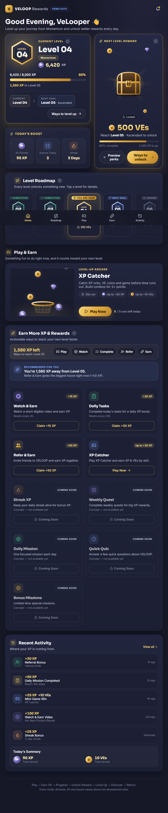 Tablet | 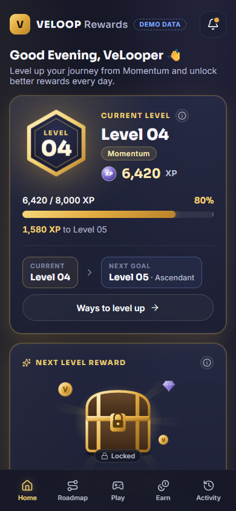 Mobile |
| 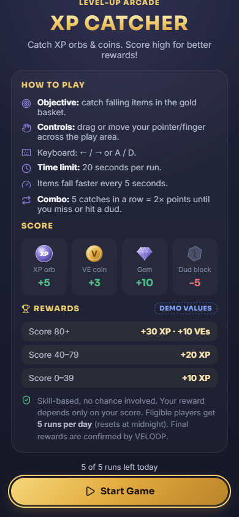 Game start | 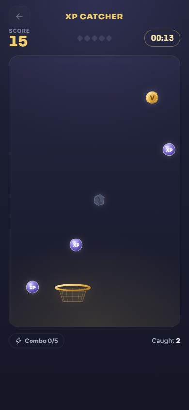 Gameplay | 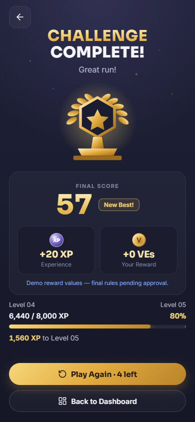 Game result |
| 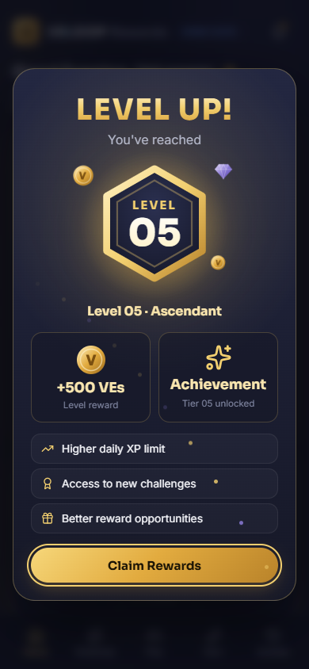 Level-up | 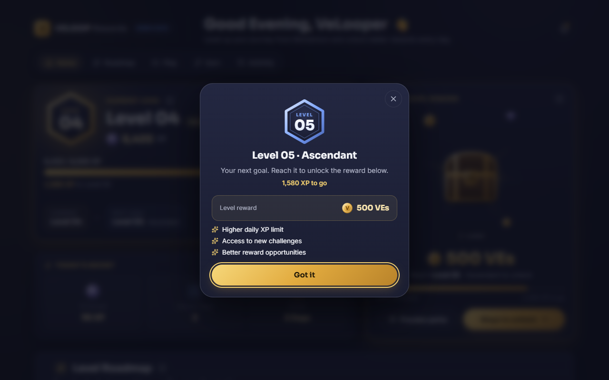 Roadmap detail | 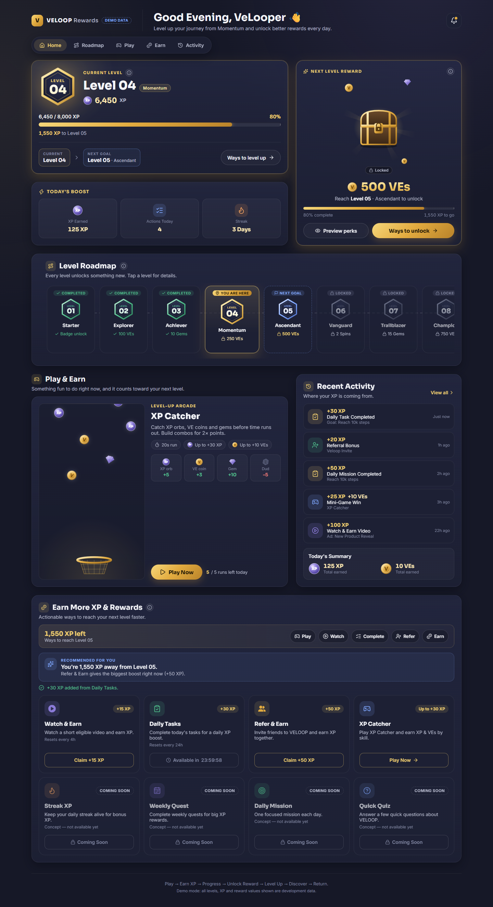 Earning (claimed + cooldown) |
| 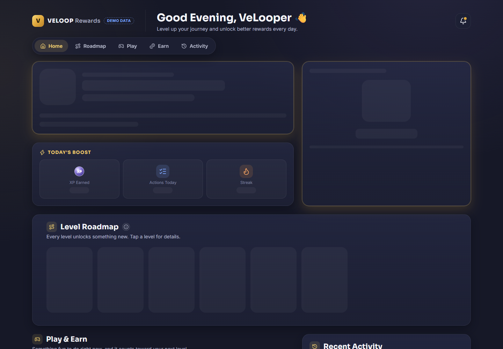 Loading | 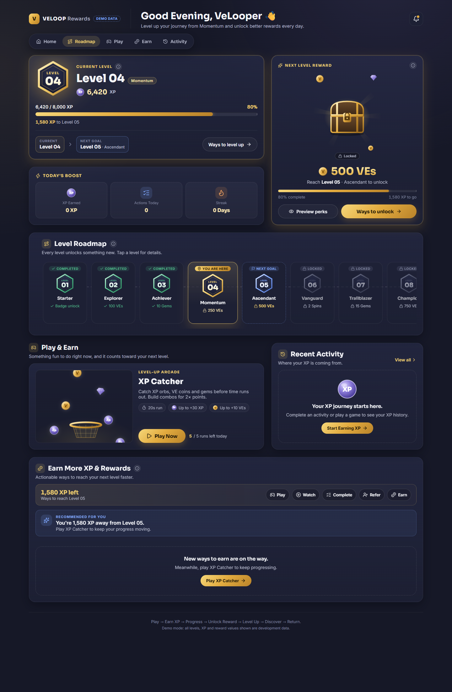 Empty | 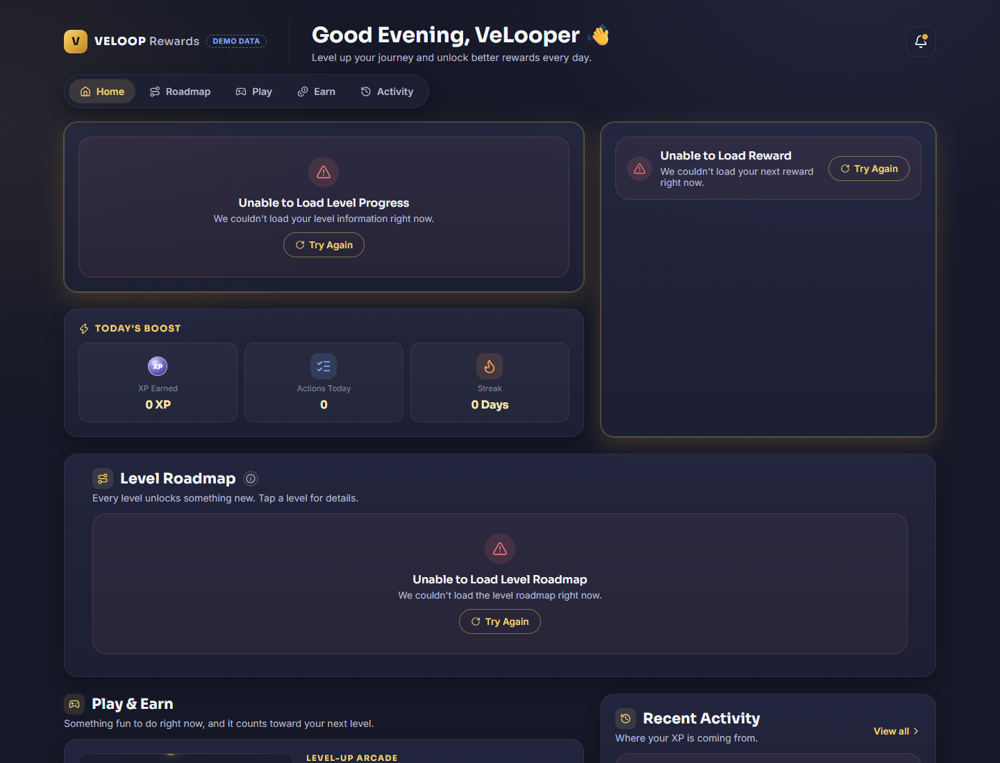 Error |
| 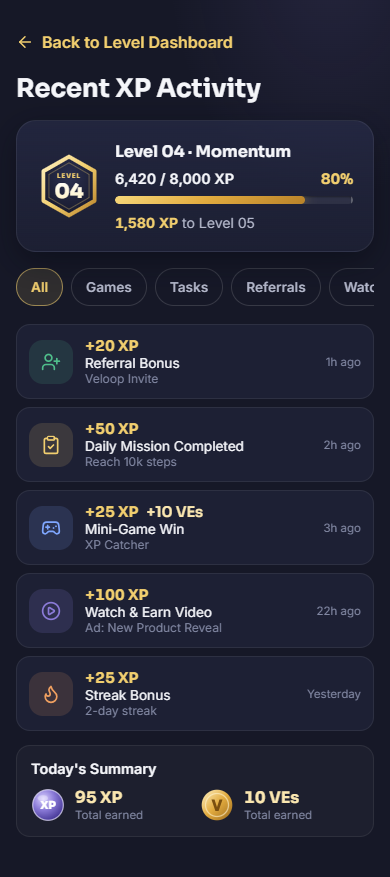 Activity page | 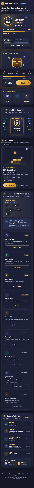 Mobile (full page) | 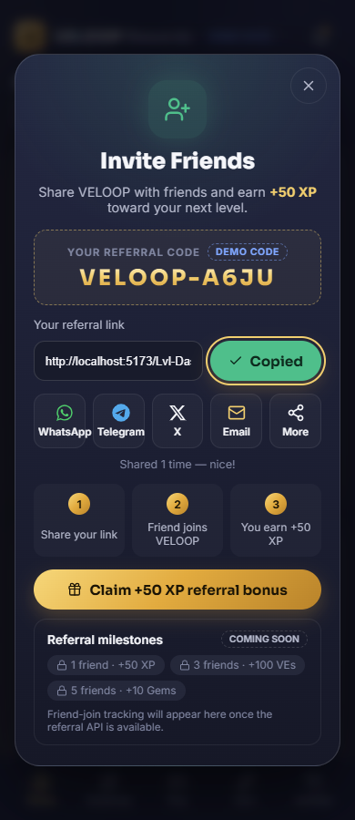 Refer & Earn |

## 16. Live Demo

`https://<your-project>.vercel.app/Lvl-Dashboard` ← _replace after deploying_

Deploy on Vercel: import the repo → Framework **Vite** → Build `npm run build` → Output `dist`. `vercel.json` already contains the `/api` proxy and the SPA rewrite, so `/Lvl-Dashboard` works on refresh and as a direct link.

## 17. GitHub Repository

`https://github.com/<your-username>/<repo>` ← _replace after pushing_

`node_modules`, `dist`, `.env*` (except `.env.example`) and local tooling folders are git-ignored. The repo contains no secrets or API keys.

## 18. Author

**<Your Name>** — Frontend Developer Intern, VELOOP Rewards ← _replace_

---

<sub>All game reward tiers, concept features and mock-mode values are **development/demo values** until the official reward rules are approved.</sub>
